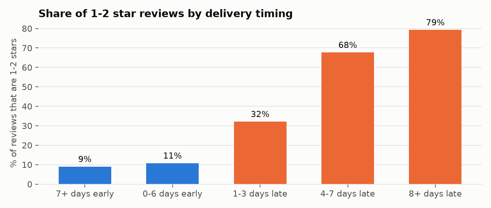
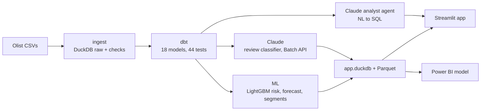

# Marketplace Pulse: why late deliveries cost more than they look

An end-to-end analytics project on 99,441 orders from Olist, a Brazilian online marketplace (Sep 2016 to Aug 2018). It goes from raw CSVs to a tested data model, a late-delivery prediction model, a demand forecast, customer segments, Claude-classified customer reviews, an AI analyst that answers questions in SQL, a Streamlit app and a Power BI model.

**Tools:** Python · DuckDB · dbt · Prefect · LightGBM · statsforecast · scikit-learn · MLflow · Claude API · Streamlit · Power BI (TMDL) · GitHub Actions

Live app: _link added after deploy_ · [Case study](docs/case_study.md) · [Analysis notebook](analysis/delivery_impact.ipynb) · [Power BI model](powerbi/)

## Business questions

1. How often do orders arrive late, and when?
2. What does a late delivery do to reviews and repeat purchases?
3. Where does lateness come from: sellers, carriers, regions or product types?
4. Can we flag risky orders at the moment they are placed?
5. Why are the unhappy customers whose orders arrived on time still unhappy?
6. How much demand is coming, and how far can a forecast be trusted?

## Key findings

- **Late deliveries are 6.8% of delivered orders but drive the bad reviews.** Orders that arrive early or on the day get a 1-2 star review about 10% of the time. One to three days late, that rises to 32%; four or more days late, to 68-79%. The gap is the same size in every region of Brazil.
- **Late first orders lose repeat buyers.** Customers whose first order was late came back 3.05% of the time, against 4.13% for on-time first orders (26% fewer, p = 0.0014). This is an association, not a controlled test.
- **Most lateness happens after the seller ships.** 72% of late orders left the seller before its deadline. The promised delivery date and the carrier leg are the bigger levers, not seller discipline.
- **Geography and peak months matter; product category barely does.** Alagoas runs at 21% late and São Paulo at 4.5%. The late rate hit 12% in Nov 2017 and 19% in Mar 2018. Across categories it only ranges from 4% to 8%.
- **The risk model catches a third of late orders in the riskiest 10%.** On orders it never saw (Apr-Jul 2018), the top risk decile holds 32.7% of late orders, against 14.5% for a state-based baseline. Its main drivers are the promised delivery time and the customer's state.
- **"Unhappy but on time" is a fulfillment problem.** Claude classified all 10,839 one- and two-star reviews. For the 12.8k customers who were unhappy without a late delivery, the top complaints are missing items (22%), items not as described (18%), orders they say never arrived (17%), damage (14%) and wrong items (13%).
- **A naive forecast beat ETS and ARIMA.** The backtest window held real shocks (orders halved in the week of the May 2018 truckers' strike), so the app uses the naive forecast with 80% intervals.



## How it works



One command runs the whole pipeline with Prefect: `uv run python flows/pipeline.py`.

| Layer | What it does | Where |
|---|---|---|
| Data engineering | Loads 9 CSVs into DuckDB with row-count, key and orphan checks; dbt builds a star schema (2 facts, 4 dimensions) with 44 tests, including a check that the marts keep every order and every real of GMV | `ingest/`, `dbt/` |
| Analysis | Late-delivery impact on reviews and repeat purchases, with significance tests and a check by region | `analysis/` |
| Machine learning | LightGBM late-delivery classifier on point-in-time features (seller history only uses orders whose outcome was known), weekly category forecast backtested against baselines, KMeans customer segments; all runs logged to MLflow | `ml/` |
| AI | Claude Opus 5.5 translates and labels Portuguese reviews (Batch API, structured JSON, resumable; $12.75 for 10,839 reviews). An analyst agent writes SQL over the governed marts using the dbt metric definitions | `ai/` |
| BI | Streamlit app with six tabs; Power BI semantic model in TMDL (10 tables, 26 measures, reconciled to dbt to the cent) | `app/`, `powerbi/` |
| Engineering | Prefect pipeline, GitHub Actions CI (lint, tests, pipeline on a committed 1,000-order sample), reproducible runs | `flows/`, `.github/` |

## The AI analyst

Ask a business question in plain English and Claude answers with numbers, the SQL it ran and the result table. It works only on the `marts`, `ml` and `ai` schemas and uses the same metric definitions as dbt, so "GMV" means the same thing everywhere.

The database connection is read-only with file and network access turned off and locked, so a query can only read tables already in the file. Queries also have a row cap and a 15-second timeout. On a 20-question test set with answers checked against hand-written SQL, it scored **20/20** for $0.21 in total ([results](docs/agent_eval_results.csv)).

## Model results

| | Model | Baseline |
|---|---|---|
| Late-delivery PR-AUC (test, Apr-Jul 2018) | 0.110 | 0.061 (state late rate); 0.040 random |
| Late orders caught in top 10% of risk | 32.7% | 14.5% |
| Forecast error, 4 rolling 4-week windows (MAPE) | Naive 27.3% | ETS 29.8%, ARIMA 31.7% |

## Run it

```bash
uv sync
# put the 9 Olist CSVs from Kaggle in data/raw/
uv run python flows/pipeline.py            # ingest, dbt, models, app data
uv run streamlit run app/streamlit_app.py
```

To run the AI steps, copy `.env.example` to `.env` and add an Anthropic API key, then run `flows/pipeline.py --with-ai` (it only classifies reviews it hasn't seen) or `python -m ai.eval_agent`. The Streamlit app runs without the raw data or a key, because `app/app.duckdb` is committed.

For Power BI, run `uv run python app/build_app_db.py`, then open `powerbi/MarketplacePulse.pbip` and refresh. `powerbi/REPORT_SPEC.md` lists the report pages.

## Data

Code: MIT (see [LICENSE](LICENSE)). Data: [Brazilian E-Commerce Public Dataset by Olist](https://www.kaggle.com/datasets/olistbr/brazilian-ecommerce), CC BY-NC-SA 4.0. The raw files are not in this repo. `app/app.duckdb` and `tests/fixtures/olist_sample/` are derived from it under the same licence.
